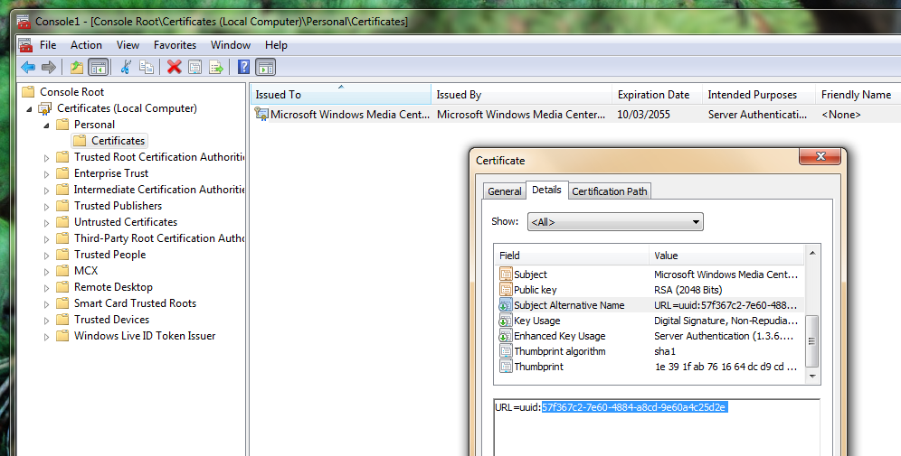

# XEXSled

small tool to send an arbitrary* XEX through the Media Center Extender image
download protocol on the Xbox 360

**This is NOT an exploit. This will not run an unsigned executable unless the
console's hypervisor is already patched (RGH, BadUpdate, etc).** This also isn't
a useful tool (yet..?), it is a fun toy I made to learn :)

Associated docs:
[Media Center Extender protocol documentation on my x360-research repo](https://github.com/InvoxiPlayGames/x360-research/blob/master/official-software/networking/media_center_extender.md)

## Usage

1. Pair your Xbox 360 to a Windows Vista or Windows 7 machine/VM.
    * If using a VM, you have to bridge the network adapter directly,
      rather than NAT.

2. Get the Media Center Extender UUID of your Windows machine.
    * Open the Microsoft Management Console, add a Certificates snap-in to view
      the Local Machine's certificates.
    * 

3. `python xexsled.py uuid-you-got ./path/to/your.xex`
    * Shut down the Windows machine, or move the XEX file out of the
      "`\Windows\ehome\MCX\X02\`" folder, to prevent conflicts.
    * You will have to compile your XEX with the version `2.0.25960.4` or change the script to match.
    * The XEX requires very strict flags, media flags and base address. (TODO)

4. Remove any storage devices from your Xbox or delete the "Media Center
   Extender" item from the Storage section of the dashboard.

4. Launch Windows Media Center on your Xbox.
